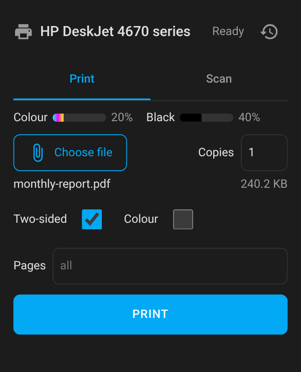
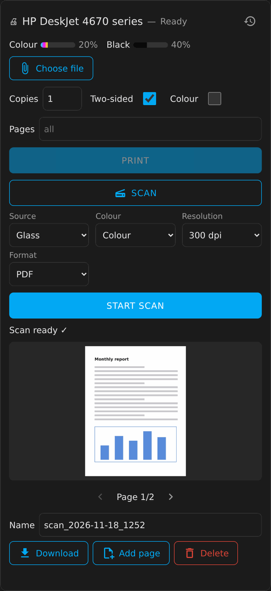
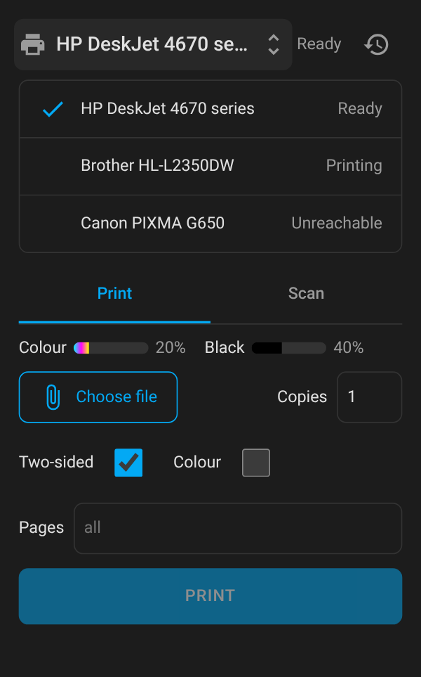
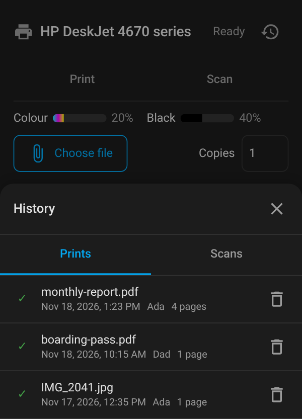
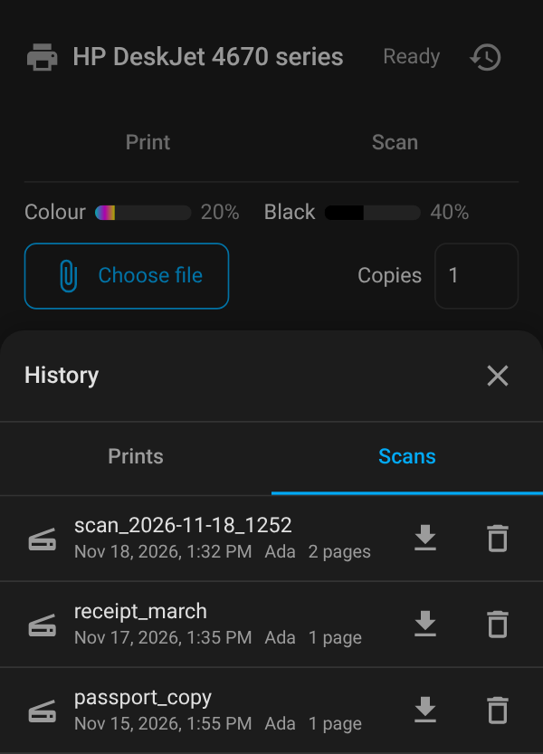
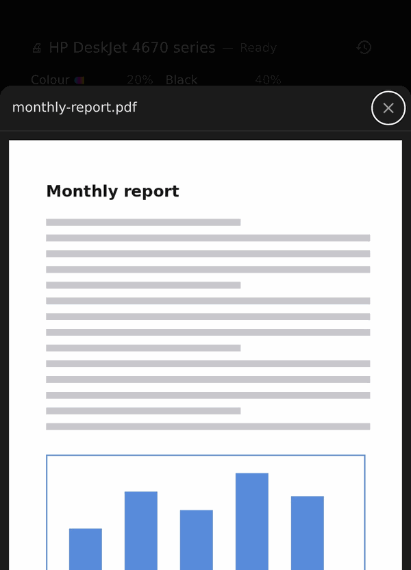

# Home Print

[](https://github.com/ada-kilinc/home-print/actions/workflows/ci.yml)
[](https://github.com/ada-kilinc/home-print/releases)
[](https://hacs.xyz)

Print and scan with your network printer from a Home Assistant dashboard, wherever you can open Home Assistant.

> **Early release.** Tested in code and against a real HP DeskJet 4670, not yet in daily use. Please open an issue when something breaks.

<p>
  
  
</p>

## Features

- Finds IPP / AirPrint printers on the network, or add one by IP.
- Sensors for status, ink or toner levels, problems and the last job.
- Prints PDF, JPEG and PNG, converting when the printer can't take a format. Supports two-sided, copies, colour and page ranges. Shrinks large phone photos.
- Scans over eSCL / AirScan to PDF or JPEG, saved in the **Media** panel.
- A dashboard card with Print and Scan tabs, history and previews.
- `home_print.print_file` and `home_print.scan` actions for automations.

Not supported yet: Word/ODF files (save as PDF), USB-only printers, SANE scanners and OCR.

## Install

[](https://my.home-assistant.io/redirect/hacs_repository/?owner=ada-kilinc&repository=home-print&category=integration)
[](https://my.home-assistant.io/redirect/config_flow_start/?domain=home_print)

1. In HACS, add `https://github.com/ada-kilinc/home-print` as a custom repository (type **Integration**), download **Home Print** and restart Home Assistant.
2. Go to **Settings → Devices & services**. Your printer should appear as discovered. If it doesn't, add **Home Print** and enter the printer's IP address.
3. On a dashboard: **Edit → Add card → Home Print**. No resource setup is needed.

Works on all installation types. Nothing is exposed to the internet: the card goes through Home Assistant's own login.

## Card

```yaml
type: custom:home-print-card
entry_id: <printer>   # optional; the visual editor fills it in
title: Printer        # optional; only used with a single printer
show_ink: true        # optional
```

- **Choose file** opens the file dialog on a computer, the system sheet on iPhone/iPad, and a small menu (files, photos, camera) on Android.
- **Several printers:** tap the printer's name in the header to switch. Each browser remembers its choice. A running print or scan keeps going while another printer is shown.
- **History:** the clock icon opens your prints and scans. Tap an entry to preview it.

<p>
  
  
  
  
</p>

## Options

Under **Configure** for each printer:

| Option | Default |
| --- | --- |
| Default two-sided and colour mode | your choice |
| Max file size | 25 MB |
| Polling interval | 60 s |
| Only admins can print | off (limits printing, scanning and deleting, not viewing) |
| Keep files (days) | 7 (0 keeps no files) |
| Scanner address | found automatically, e.g. `http://192.168.1.20/eSCL` |
| Keep scans (days) | 30 (0 keeps them forever) |
| Max space for scans | 2000 MB (oldest scans are deleted first) |

If the scanner doesn't answer at start-up (the printer is asleep, for example), Home Print tries again after 1, 5 and 30 minutes, then hourly for a day.

## Scanning action

```yaml
action: home_print.scan
data:
  config_entry_id: <printer entry id>
  source: platen        # platen | adf | adf_duplex
  color_mode: gray      # color | gray | bw
  resolution: 300
  format: pdf           # pdf | jpeg
  file_name: invoice    # optional
  folder: /media/documents   # optional extra copy
response_variable: scan  # scan.path, scan.copy, scan.name, scan.pages
```

## Privacy

- Printed files are kept for **Keep files (days)** under `<config>/home_print/<entry_id>/`, so the history can preview them.
- Scans are saved in the media folder under `home_print/scans/YYYY-MM/`.
- Every logged-in user can see the history, the previews and the scans.
- Both are included in backups. Deleting an entry doesn't remove it from backups you already made.

## FAQ

**Do I also need the built-in IPP integration?** No. If both are set up, the printer just gets two sets of sensors.

**Can I print away from home?** Yes, through any remote access you already use (Tailscale, Nabu Casa, …).

**Where are my scans?** In the **Media** panel, under `home_print/scans/` (`/media` on Home Assistant OS).

**The card says "Custom element doesn't exist".** See [Troubleshooting](docs/troubleshooting.md#the-card-doesnt-show-up).

**Something doesn't work with my printer.** Open an issue and attach the diagnostics file: **Settings → Devices & services → Home Print → ⋮ → Download diagnostics**. Serial numbers, addresses and locations are removed from it.

## Contributing

Issues and pull requests are welcome, from typo fixes to "this didn't work on my printer" reports. Please mention your printer model and Home Assistant version.

```bash
python3 -m venv .venv && .venv/bin/pip install -r requirements_test.txt
.venv/bin/pytest -q            # Python tests
npm install && npm test        # card tests
npm run build                  # rebuild the card from frontend/src/
python scripts/screenshots.py  # redraw docs/images (needs playwright)
```

The card's source is in `frontend/src/`. `npm run build` bundles it into `custom_components/home_print/frontend/home-print-card.js`, which is committed so HACS needs no build. CI fails if the two don't match. See [ADR 1](docs/adr/0001-card-modules.md).

`scripts/remote_check.py` checks a printer over the network without printing (`--print` runs up to two small test jobs, `--scan-info` and `--scan` check the scanner). Its saved `escl_*.xml` files contain serial numbers, so don't post them.

**Releases:** bump `version` in `manifest.json`, push, then push a matching tag (`git tag v<version> && git push origin v<version>`). The release workflow checks the tag against the manifest, builds `home_print.zip` and publishes the release. CI runs ruff, pytest, the card tests, hassfest and HACS validation on every push and pull request.

## License

[MIT](LICENSE)
